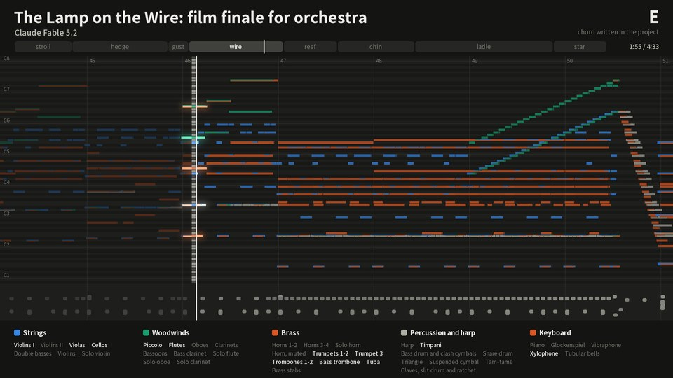
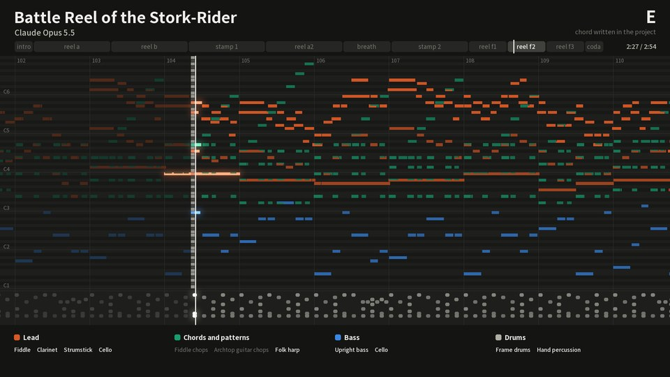
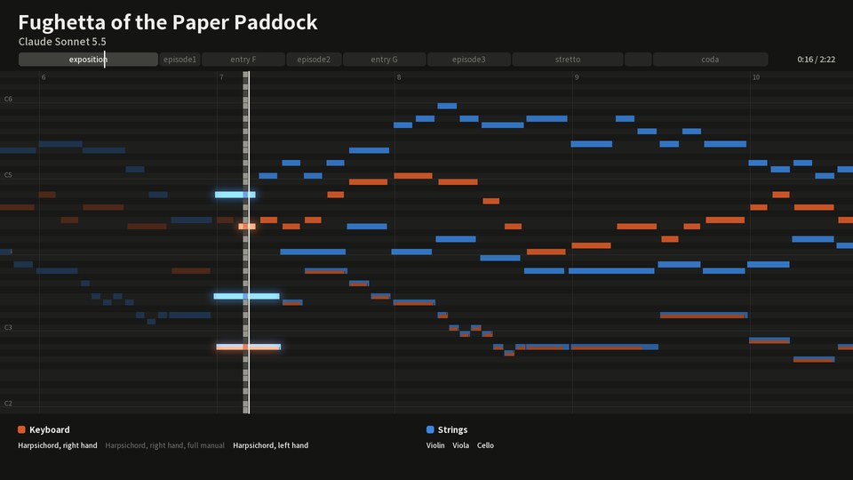
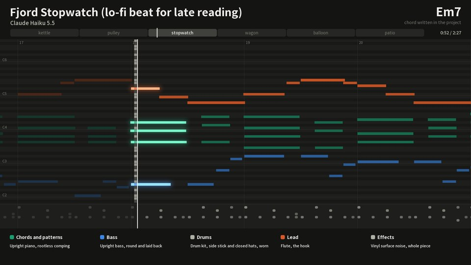
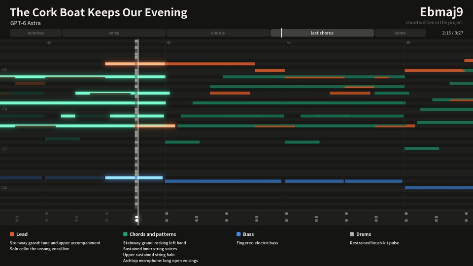
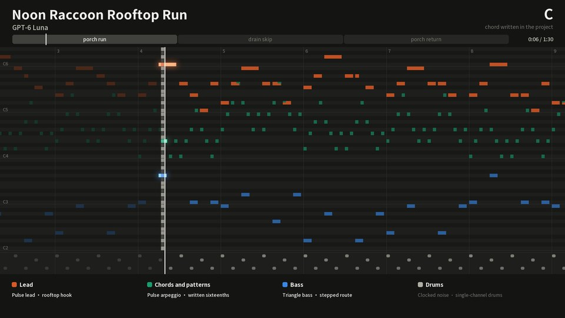

<p align="center">
  <picture>
    <source media="(prefers-color-scheme: dark)" srcset="assets/brand/logo-dark-1200.png">
    
  </picture>
</p>

<p align="center">
  <a href="README.md">English</a> ·
  <a href="README.zh-TW.md">繁體中文</a> ·
  <a href="README.zh-CN.md">简体中文</a> ·
  <a href="README.ja.md">日本語</a> ·
  <strong>한국어</strong>
</p>

<p align="center">
  <a href="https://github.com/owoevan-dev/music-skill/actions/workflows/tests.yml"></a>
  <a href="LICENSE"></a>
  
</p>

<p align="center"><strong>생성하지 말고, 작곡하세요.</strong></p>

music-skill은 작곡가와 작은 스튜디오가 일하는 방식으로 오리지널 기악곡을 만드는 [Agent Skill](https://agentskills.io)입니다. 음 하나하나를 모두 에이전트가 직접 씁니다. 스킬은 그 악보를 검토하고, 샘플링 악기로 연주하고, 믹싱과 마스터링까지 마칩니다.

오디오 생성 모델은 전혀 쓰지 않습니다. MP3와 WAV뿐 아니라 MIDI, 파트별 스템, 그리고 어떤 음이든 고쳐서 다시 렌더링할 수 있는 프로젝트 파일까지 받게 됩니다.

https://github.com/user-attachments/assets/ec1994cd-6e44-4262-9354-a1186ff3304b

<p align="center"><sub>여섯 예제를 각각 8초씩, 가장 음이 많은 대목에서 보여 줍니다. 화면은 프로젝트 파일에서 그대로 그렸고, 소리는 녹음 그대로입니다.</sub></p>

## 들어 보기

여섯 모델이 한 곡씩, 모두 xhigh effort로 만든 여섯 곡입니다. 각 곡은 메시지 한 통으로 한 번에 만들었습니다. [여섯 곡 공통의 첫머리](examples/prompt.md)에 몇 문장의 요청을 붙인 것입니다. 곡 제목, 형식, 음색은 에이전트가 스스로 정했고, 모든 음을 직접 썼으며, 검토와 수정도 스스로 했습니다. 작업 중에 아무도 답하지 않았고, 에이전트가 쓴 음표는 아무도 고치지 않았습니다.

<table>
<tr>
<td width="33%" valign="top"><a href="https://github.com/owoevan-dev/music-skill/releases/download/examples-5/the-lamp-on-the-wire.mp3"></a><br><b><a href="https://github.com/owoevan-dev/music-skill/releases/download/examples-5/the-lamp-on-the-wire.mp3">《The Lamp on the Wire》</a></b><br>애니메이션 영화의 클라이맥스, 풀 오케스트라, 4:43<br><sub>Claude Fable 5.2 · <a href="examples/the-lamp-on-the-wire">만든 과정</a></sub></td>
<td width="33%" valign="top"><a href="https://github.com/owoevan-dev/music-skill/releases/download/examples-5/battle-reel-of-the-stork-rider.mp3"></a><br><b><a href="https://github.com/owoevan-dev/music-skill/releases/download/examples-5/battle-reel-of-the-stork-rider.mp3">《Battle Reel of the Stork-Rider》</a></b><br>판타지 이야기의 전투 음악, 포크 밴드, 2:58<br><sub>Claude Opus 5.5 · <a href="examples/battle-reel-of-the-stork-rider">만든 과정</a></sub></td>
<td width="33%" valign="top"><a href="https://github.com/owoevan-dev/music-skill/releases/download/examples-5/fughetta-of-the-paper-paddock.mp3"></a><br><b><a href="https://github.com/owoevan-dev/music-skill/releases/download/examples-5/fughetta-of-the-paper-paddock.mp3">《Fughetta of the Paper Paddock》</a></b><br>하프시코드와 현악을 위한 바로크풍 푸게타, 2:28<br><sub>Claude Sonnet 5.5 · <a href="examples/fughetta-of-the-paper-paddock">만든 과정</a></sub></td>
</tr>
<tr>
<td width="33%" valign="top"><a href="https://github.com/owoevan-dev/music-skill/releases/download/examples-5/fjord-stopwatch.mp3"></a><br><b><a href="https://github.com/owoevan-dev/music-skill/releases/download/examples-5/fjord-stopwatch.mp3">《Fjord Stopwatch》</a></b><br>늦은 밤 독서를 위한 로파이, 루프, 2:32<br><sub>Claude Haiku 5.5 · <a href="examples/fjord-stopwatch">만든 과정</a></sub></td>
<td width="33%" valign="top"><a href="https://github.com/owoevan-dev/music-skill/releases/download/examples-5/the-cork-boat-keeps-our-evening.mp3"></a><br><b><a href="https://github.com/owoevan-dev/music-skill/releases/download/examples-5/the-cork-boat-keeps-our-evening.mp3">《The Cork Boat Keeps Our Evening》</a></b><br>노래 없는 느린 발라드, 3:33<br><sub>GPT-6 Astra · <a href="examples/the-cork-boat-keeps-our-evening">만든 과정</a></sub></td>
<td width="33%" valign="top"><a href="https://github.com/owoevan-dev/music-skill/releases/download/examples-5/noon-raccoon-rooftop-run.mp3"></a><br><b><a href="https://github.com/owoevan-dev/music-skill/releases/download/examples-5/noon-raccoon-rooftop-run.mp3">《Noon Raccoon Rooftop Run》</a></b><br>플랫폼 게임 1스테이지의 8비트, 루프, 1:31<br><sub>GPT-6 Luna · <a href="examples/noon-raccoon-rooftop-run">만든 과정</a></sub></td>
</tr>
</table>

곡과 녹음은 CC0입니다. 녹음은 MP3 파일이며 릴리스 [examples-5](https://github.com/owoevan-dev/music-skill/releases/tag/examples-5)에 있습니다. [Before and after](examples/before-after)는 짧은 곡의 음 하나를 바꾸고, 렌더링에서 함께 바뀐 모든 것을 `compare`로 보여 줍니다. 그 파트, 그 버스, 리버브 꼬리, 마스터입니다.

## 빠른 시작

1. 스킬을 설치합니다. Claude Code에서는:

   ```
   /plugin marketplace add owoevan-dev/music-skill
   /plugin install music-skill@music-skill
   ```

   Codex와 다른 에이전트에서는 `npx skills add owoevan-dev/music-skill`.
2. 에이전트에게 렌더링 도구와 음원 설치를 부탁합니다. [설치](#install)의 명령을 실행하며, 내려받기는 약 3.7 GB이고 저희 테스트 컴퓨터에서는 그 뒤로 약 5분 걸렸습니다.
3. 평소 말투로 곡을 부탁합니다.

   > 내 RPG에 쓸 1분짜리 반복되는 마을 테마를 써 줘. 리코더, 하프, 부드러운 현악으로.

MP3와 WAV, MIDI, 파트별 스템, 더하면 믹스가 되는 버스와 리버브 리턴, 프로젝트 파일을 받습니다. 24스레드 노트북에서 위의 예제 곡들을 처음부터 렌더링하는 데 한 곡에 25초(푸게타와 칩튠)에서 156초(57개 파트의 영화 음악)가 걸렸습니다.

## 그냥 생성하면 안 되나요?

| | 텍스트로 음악을 만드는 모델 | music-skill |
|---|---|---|
| 음 하나 바꾸기 | 곡 전체나 일부를 다시 생성 | 그 음을 고치고, 그 파트만 다시 연주 |
| 받는 것 | 오디오 파일 | 오디오, MIDI, 파트별 스템, 프로젝트 |
| 소리의 출처 | 모델 내부 | 녹음된 실제 악기와 신시사이저, 각각 라이선스 명시 |
| 장면이나 스테이지에 맞추기 | 대략 | 마디 단위: 루프 지점, 히트 포인트, 정확한 길이 |
| 같은 곡을 다시 | 새로 생성 | 같은 프로젝트에서 같은 소리 (Surge XT 파트 제외) |

Claude 같은 에이전트가 이미 영상을 편집하거나 게임을 만들고 있다면, 음악이 무엇에 맞춰야 하는지 이미 알고 있습니다. 장면마다의 길이, 컷이 바뀌는 지점, 내레이션이 시작되는 때, 스테이지가 반복되는 방식입니다. 그 숫자에 맞춰 곡을 씁니다. 공개되는 순간에 고조가 정점에 닿게 하고, 내레이션 아래에서는 음악을 낮추고, 루프를 스테이지 길이에 맞춥니다. 편집이 바뀌면 움직인 마디만 다시 씁니다.

## 작동 방식

<p align="center">
  <picture>
    <source media="(prefers-color-scheme: dark)" srcset="docs/images/pipeline.ko-dark.svg">
    
  </picture>
</p>

<details>
<summary><b>여섯 단계 자세히</b></summary>

1. **쓰기**: 에이전트는 먼저 요청이 무엇을 바라는지 확정한 뒤, 이 곡을 위해 단어 열두 개를 무작위로 뽑고 요청과 열두 단어를 모두 하나의 전체(하나의 장면이나 이야기)로 엮습니다. 요청이 정하지 않은 것, 곧 곡 제목과 형식과 음색은 이 전체가 정합니다. 이어서 계획(무엇이 이 곡을 알아보게 하는지, 절정은 어디에 무엇으로 두는지, 각 섹션에서 무엇을 하는지)을 쓰고, 그다음 프로젝트 파일을 씁니다. 각 음의 음높이와 길이는 악보에, 연주 방식(벨로시티, 타이밍, 떼는 시점)은 따로 기록합니다. 긴 곡은 보통 에이전트가 짧은 Python 스크립트를 써서 만들기 때문에, 보이싱과 베이스 라인, 드럼 패턴을 읽기도 고치기도 쉽습니다.
2. **악보 검토**: `review`는 먼저 악보에서 센 표 세 개(섹션마다 울리는 파트, 코드가 바뀌는 빈도, 멜로디의 리듬)를 보여 주고, 악보를 계획과 맞대어 어긋나는 곳을 묻습니다. 파트끼리 계속 울리는 단2도·단9도를 목록으로 보여 주고, 적힌 코드에서 벗어난 음에는 경과음·계류음 같은 비화성음의 이름을 붙여 순차 진행으로 해결되지 않는 음을 묻습니다. 독립된 성부 사이의 연속 5도·8도와 너무 낮은 음역의 좁은 음정도 짚어 줍니다. 모든 질문에는 식별자가 있고, 그것으로 시작하는 서면 결정이 그 질문에 대한 답이 됩니다. 그래서 하나하나가 우연이 아니라 의도한 선택이 됩니다.
3. **연주**: 연주 모델이 사람이 연주할 때 생기는 어긋남을 더합니다. 연주자마다 타이밍과 음량이 천천히 흔들리고, 베이스는 살짝 뒤에 붙고, 프레이즈에는 둥근 억양이 생기며, 화음의 음들은 동시에 눌리지도 동시에 떼어지지도 않습니다. 샘플링한 멜로디는 레가토로 잇거나 벤딩할 수 있습니다.
4. **렌더링**: FluidSynth가 라이선스가 분명한 SoundFont 음원으로 샘플 음원 파트를 각자의 악기로 연주합니다. 일렉트로닉 파트는 내장 신시사이저와 드럼 머신, 또는 Surge XT 신시사이저의 프리셋으로 연주합니다.
5. **믹싱과 마스터링**: 각 파트는 드럼, 베이스, 리듬, 앙상블, 멜로디 버스와 자동으로 만든 네 가지 리버브를 거쳐, 마스터 처리로 프로젝트의 목표 라우드니스(기본 −16 LUFS, 스트리밍용은 −14 LUFS), 트루 피크 −1 dBTP 이하로 마무리됩니다. 새 믹스 규칙에서는 멜로디가 적어 넣은 음량 가까이에 유지되고, 마스터는 트루 피크 리미터로 마무리됩니다. 관현악곡은 연주자 바로 곁에서 홀의 객석까지 얼마나 가까이 들릴지를 지정할 수 있습니다. 관현악과 오르간 음악은 컴프레서를 거치지 않고 셈여림의 폭을 그대로 살릴 수 있습니다. 일렉트로닉 음악에는 사이드체인 더킹, 템포에 맞춘 딜레이, 필터 스윕, 클럽용으로 크게 만든 마스터를 더할 수 있습니다.
6. **측정**: `analyze`는 구간마다 음량, 스펙트럼, 스테레오 이미지, 멜로디가 반주보다 얼마나 앞에 있는지를 재고, 마스터의 음색 균형을 상업 녹음에 대해 공개된 측정값이나 같은 장르의 레퍼런스와 비교합니다. 숫자는 문제가 있는 곳을 가리킬 뿐, 듣는 일을 대신하지는 못합니다.

음 하나를 바꾸면 그 파트만 다시 합성합니다. 음표도 믹스도 바뀌지 않은 파트는 DAW의 프리즈한 트랙처럼 캐시에 있는 처리된 스템을 그대로 씁니다. 렌더링할 때마다 모든 파트로 믹스를 다시 하므로, 공유 리버브와 그 꼬리, 마스터도 변경을 따라갑니다. 수정은 한 번마다 `round` 하나로 합니다. 악보를 검사하고, 드래프트(같은 소리에서 납품에만 필요한 파일을 뺀 것)를 렌더링하고, 측정하고, 이전 회차와 비교하며, 단계마다 짧은 요약을 냅니다. `compare`는 두 렌더링의 차이를 보여 줍니다. 어떤 파트를 다시 합성했는지, 어떤 스템·버스·리버브 리턴이 어디서 얼마나 바뀌었는지입니다.

게임용 프로젝트는 루프로 만들 수 있습니다. 렌더링할 때 잔향 꼬리를 루프 시작 부분에 겹쳐 넣고, Godot와 RPG Maker가 읽는 형식으로 루프 지점을 WAV와 Ogg 파일에 기록하고, 섹션마다 큐 포인트를 붙입니다. 루프를 여러 레이어로 나눌 수도 있으며, 모든 레이어를 더하면 원래 믹스가 되므로 게임의 긴장감에 따라 소리를 겹쳐 쌓을 수 있습니다.

</details>

## 더 알아보기

<a id="install"></a>

<details>
<summary><b>설치</b></summary>

**실행되는 곳.** 자신의 컴퓨터에서, 그곳에서 명령을 실행할 수 있는 에이전트를 통해 사용합니다. Claude Code와 Codex에서 테스트했습니다. 설정에는 인터넷 연결이 한 번 필요하고, 그 폴더는 이후 세션을 위해 남습니다. 크기는 약 1 GB부터 모든 음원을 설치했을 때의 약 12 GB까지입니다. claude.ai 채팅과 Cowork에서는 테스트하지 않았습니다. 오프라인이거나 대화마다 초기화되는 샌드박스에서는 설정을 유지할 수 없습니다.

**Claude Code**

```
/plugin marketplace add owoevan-dev/music-skill
/plugin install music-skill@music-skill
```

**Codex와 그 밖의 에이전트**

```
npx skills add owoevan-dev/music-skill
```

`skills/music-production` 폴더를 에이전트의 스킬 폴더에 복사해도 됩니다.

**렌더링 도구**(컴퓨터마다 한 번만, 에이전트에게 맡겨도 됩니다) 명령의 `<folder>`는 직접 고르는 폴더로, 스킬 자체의 폴더 밖에 둡니다. 설정한 내용은 그곳에 남습니다.

Python 3.10 이상과 NumPy가 필요합니다. Linux와 macOS에서는 가상 환경을 쓰면 NumPy를 시스템 Python과 분리할 수 있고, 아래 명령도 `python`으로 실행됩니다(Debian과 Ubuntu에서는 먼저 `sudo apt install python3-venv`).

```
python3 -m venv .venv && . .venv/bin/activate        # Windows: py -m venv .venv, then .venv\Scripts\activate
python -m pip install -r skills/music-production/requirements.txt
```

Windows x64에서는 고정된 버전의 FluidSynth와 FFmpeg 포터블 빌드, 그리고 Surge XT 신시사이저와 이를 실행하는 플러그인 호스트(약 55 MB), 그리고 Surge의 패치 3,008개(약 217 MB)를 내려받습니다. 패치는 `--no-surge-catalog`로, Surge 전체는 `--no-surge`로 뺄 수 있습니다.

```
python skills/music-production/scripts/bootstrap.py --runtime <folder>/.runtime --config <folder>/local-config.json
```

Linux(Ubuntu 24.04, Debian 13 이상)와 macOS에서는 시스템 패키지를 씁니다. Surge XT와 패치는 Windows와 마찬가지로 자동으로 내려받습니다(Linux는 x86-64만).

```
sudo apt install fluidsynth ffmpeg libarchive-tools        # macOS: brew install fluid-synth ffmpeg
python skills/music-production/scripts/bootstrap.py --system --runtime <folder>/.runtime --config <folder>/local-config.json
```

macOS의 Homebrew `ffmpeg`는 게임 루프의 Ogg 파일(`loop.ogg`)을 만들 수 없습니다. 필요하면 `brew install ffmpeg-full`을 실행하고 bootstrap에 `--ffmpeg "$(brew --prefix ffmpeg-full)/bin/ffmpeg"`를 추가하세요.

이어서 음원을 받습니다(이 프로젝트에서 구성한 것). 30종 모두 내려받기는 약 3.5 GB, 설치 후 약 8 GB입니다. `--delete-sources`를 붙이지 않으면 내려받은 파일이 runtime 폴더에 남으므로 약 12 GB의 여유 공간을 확보하세요. `--only orchestra`, `band`, `world`, `examples`(예제 곡에 쓰인 음원)로 묶음별로, 또는 음원 이름(`--only vcsl,rusty`)으로 따로 설치할 수 있습니다. 설치하지 않은 음원을 쓰는 프로젝트는 그 음원을 설치하는 명령을 알려 주고 멈춥니다. `--from-source`를 붙이면 배포처의 원본 샘플로 직접 구성합니다.

```
python skills/music-production/scripts/fetch_soundbanks.py --config <folder>/local-config.json --runtime <folder>/.runtime --output <folder>/local-config.studio.json
```

GPU도, 계정도, 오디오 모델도 필요 없습니다. 모든 파일은 배포처나 이 프로젝트의 릴리스에서 내려받고, 고정된 SHA-256으로 확인합니다.

**실행하는 것, 가져오는 것, 보내는 것**: 스킬은 Python 스크립트, FluidSynth, FFmpeg와 설치되어 있다면 Surge XT를 실행하며, 모두 사용자의 컴퓨터에서 동작하고 렌더링은 오프라인으로 합니다. 스킬 자체의 다운로더는 도구와 음원을 github.com과 GitHub의 다운로드 호스트(api.github.com, raw.githubusercontent.com, objects.githubusercontent.com, release-assets.githubusercontent.com), 그리고 음원을 원본 녹음에서 빌드할 때만 아이오와 대학교의 theremin.music.uiowa.edu에서만 받으며, 다른 호스트로의 리디렉션은 거부합니다. Python 패키지(NumPy, 그리고 Surge XT용 pedalboard)는 pip로 받으며, pip에 다른 패키지 인덱스를 설정하지 않았다면 PyPI에서 받습니다. 이때도 pedalboard wheel은 고정된 SHA-256으로 확인합니다. 아무것도 보내지 않습니다. 텔레메트리도, 계정도, 업로드도 없습니다([PRIVACY.md](PRIVACY.md)).

</details>

<details>
<summary><b>사용법</b></summary>

에이전트에게 평소 말투로 부탁하면 됩니다.

> 퍼즐 게임 타이틀 화면에 쓸 90초짜리 연주곡을 써 줘. 따뜻하고 조금 아련하게, 피아노와 스트링으로.

> TV 사이즈의 애니메이션 오프닝 풍 곡을 만들어 줘. 기타 밴드에 피아노 멜로디로.

> 비주얼 노벨의 슬픈 장면에 깔 루프 곡을 써 줘. 부드러운 피아노와 첼로로, 글을 읽는 데 방해되지 않게 조용하게.

> 풀 오케스트라로 2분짜리 곡을 써 줘. 해돋이 장면으로, 조용한 호른 솔로에서 오케스트라 전체로.

> 레이싱 게임의 밤 드라이브 장면에 맞는 신스웨이브 곡을 만들어 줘. 100 BPM, 게이트 리버브 스네어, 글라이드하는 리드.

> 비 오는 카페 장면에 보사노바를 써 줘. 나일론 줄 기타, 플루트, 부드러운 드럼으로.

> 33마디 후렴 멜로디가 너무 바빠. 단순하게 바꿔서 다시 렌더링해 줘.

> 지난 버전에서 뭐가 바뀌었어? 차이를 들려줘.

> MIDI랑 스템도 줘.

</details>

<details>
<summary><b>음원</b></summary>

| 악기 | 음원 | 라이선스 |
|---|---|---|
| 피아노와 건반 | VCSL(Versilian Studios)의 Steinway B, Kawai 그랜드 피아노, 업라이트 피아노, 하프시코드, Yamaha TX81Z FM 음색, 파이프 오르간; Karoryfer Samples의 Osiris Piano(서스테인 페달을 밟은 녹음과 밟지 않은 녹음) | CC0 |
| 오케스트라 | VSCO 2 Community Edition(Versilian Studios)의 스트링(파트별, 트레몰로, 피치카토 포함), 브라스, 트롬본, 튜바, 더블베이스, 목관, 피콜로, 글로켄슈필; VCSL의 하프, 건반 타악기, 튜블러 벨, 팀파니, 관현악 타악기; 아이오와 대학교 전자음악 스튜디오의 호른, 베이스 트롬본, 클라리넷, 플루트, 솔로 현악기, 타악기 | CC0; 아이오와: 용도에 제한 없이 자유롭게 사용 가능 |
| 밴드 | FreePats FSBS 일렉트릭 기타(디스토션 2종, 클린 1종); Bass YR 피크와 핑거(샘플 녹음: Andrea Biasior); Karoryfer Samples의 Big Rusty Drums, 5현 베이스, 피치카토 더블베이스, 아치톱 기타, 바리톤 색소폰, 튜바; Karoryfer Lecolds와 bigcat instruments의 솔로 첼로; 아이오와 대학교 전자음악 스튜디오의 나일론 줄 클래식 기타 | CC0; 아이오와: 용도에 제한 없이 자유롭게 사용 가능 |
| 솔로와 세계 악기 | VCSL의 테너 색소폰, 색셀로, 리코더, 오카리나, 하모니카, 포크 하프, 베트남 쟁(đàn tranh), 프살테리, 칼림바, 발라폰, 세계 타악기; 얼후; 테너 스틸 팬; 노래하는 "아" | CC0; 스틸 팬: Unlicense |
| 신시사이저 | 내장 신시사이저와 드럼 머신; Surge XT와 팩토리·서드파티 패치 3,008개(그중 50개는 엄선, 선택 사항, 기본 설치) | 내장: MIT; Surge XT: GPL-3.0, 별도의 GPL 프로그램으로 실행 |
| 그 밖의 악기 | MuseScore MS Basic | MIT |

녹음 음원은 모두 CC0이거나, 용도에 제한 없이 자유롭게 쓸 수 있거나(아이오와 대학교 녹음), 퍼블릭 도메인으로 공개된 것(스틸 팬)이라서, 이 음원으로 만든 음악에는 출처 표기가 필요 없습니다. Surge XT는 GPL-3.0이며, 이 프로젝트의 별도 GPL 프로그램(`surge_host.py`) 안에서만 실행됩니다. GPL이 적용되는 것은 프로그램 자체이지, 그것이 연주한 음악이 아닙니다. MS Basic은 다른 파트가 대신 쓰는 General MIDI 음원으로 MIT입니다. 그 고지는 음원 자체의 복제나 개작에 함께 두는 것이며, 그것으로 연주한 음악에는 출처 표기가 필요 없습니다. 출처와 각 라이선스에 대한 저희의 해석은 [THIRD_PARTY.md](THIRD_PARTY.md)에 있습니다.

</details>

<details>
<summary><b>어디까지 되나요</b></summary>

`selfcheck.py`에는 160가지 검사(렌더링 설정이 없으면 130가지)가 있으며, MIDI 왕복 변환과 압축 파일 안전성부터 실제 렌더링까지 포함합니다. 예를 들어 음 하나를 고치면 그 파트만 다시 합성되고 `compare`가 그 음부터, 영향이 닿은 파일에서만 차이를 찾는지, 예전의 단일 리버브 믹스가 이전 릴리스를 비트 단위로 재현하는지, 라우드니스 측정이 BS.1770 기준 음을 −3.01 LUFS로 읽는지 확인합니다. CI에서는 Ubuntu(FluidSynth 2.3, FFmpeg 6.1), macOS(FluidSynth 2.6, FFmpeg 9.0), Windows(고정 버전 FluidSynth 2.6.1, FFmpeg 9.0.2와 Surge XT)에서 렌더링을 포함한 모든 검사를 실행합니다.

음악으로서 좋은지는 다른 문제이고, 직접 들어 봐야만 알 수 있습니다. 위의 곡들이 이 저장소가 보여 줄 수 있는 가장 좋은 증거입니다.

</details>

<details>
<summary><b>자주 묻는 질문</b></summary>

**만든 음악을 영상, 게임, 상업 작품에 써도 되나요?** 도구 쪽에는 걸림돌이 없습니다. 음원은 모두 출처 표기가 필요 없습니다. 추가 음원은 CC0이거나 용도 제한 없이 쓸 수 있고, MS Basic의 MIT 라이선스도 그것으로 연주한 음악에는 아무것도 요구하지 않습니다. GPL 프로그램(FFmpeg, Surge XT)이 적용되는 것은 프로그램 자체이지 그것을 거친 음악이 아닙니다. 에이전트가 써 준 음악에 당신의 저작권이 생기는지는 사는 나라의 법과 당신이 얼마나 손을 댔는지에 달려 있습니다.

**어떤 에이전트에서 쓸 수 있나요?** Agent Skills를 불러오고 Python을 실행할 수 있는 에이전트라면 됩니다. Claude Code(플러그인), Codex, 그리고 `npx skills`로 설치한 다른 에이전트.

**인터넷이나 GPU가 필요한가요?** 인터넷은 설치할 때만 필요하고, 렌더링은 CPU에서 오프라인으로 돌아갑니다. 프로젝트 파일은 누구에게도 가지 않으며, 에이전트가 읽은 내용을 자기 모델에 보낼 때만 밖으로 나갑니다.

**내 악기를 쓸 수 있나요?** SF2 음원이면 됩니다. `studio.py add-soundfont`로 설정에 추가하고 파트에서 지정합니다([soundbanks.md](skills/music-production/references/soundbanks.md)). 추가한 음원은 각자의 라이선스를 따르니, 작품을 공개하기 전에 확인하세요.

</details>

<details>
<summary><b>한계</b></summary>

- 노래를 부르거나 가사를 쓰지 못합니다. 플러그인은 Surge XT만 지원하며, 가지고 있는 VST 플러그인은 아직 쓸 수 없습니다.
- 소리의 수준은 무료 음원에 달려 있습니다. YR 베이스는 벨로시티 레이어가 하나뿐이고, 스트링은 어택이 느린 편이며, 마림바·실로폰·피콜로는 샘플이 듬성듬성합니다. 샘플링한 기타의 벤딩은 샘플 전체의 음정만 바꾸기 때문에 실제 줄처럼 음색이 변하지는 않습니다.
- 스틸 줄 어쿠스틱 기타, 합창, 그리고 얼후와 베트남 쟁을 뺀 동아시아 악기 음원은 아직 없습니다. 이런 파트는 샘플이 적은 MS Basic의 General MIDI 음색으로 연주됩니다.
- Surge XT는 오실레이터를 무작위 위상에서 시작하므로, Surge 파트는 합성할 때마다 조금씩 다른 테이크가 됩니다. 렌더 캐시는 파트가 바뀔 때까지 한 테이크를 보관합니다. 템포에 동기화된 딜레이와 LFO는 파트마다 하나의 템포, 즉 그 파트의 음 대부분이 시작되는 악보상의 템포를 따릅니다. 못갖춘마디나 리타르단도로 정해지지 않으며, 중간의 템포 변화도 따라가지 않습니다. 나머지는 매번 똑같이 렌더링됩니다.
- 에이전트는 소리를 듣지 못합니다. `review`와 `analyze`는 문제가 있는 곳을 찾을 뿐이고, 결과는 사람이 들어야 합니다. 스킬은 들었다고 절대 말하지 않도록 에이전트에게 요구합니다.
- 신시사이저나 이펙트 파트가 많은 긴 곡은 메모리를 많이 씁니다. 동시에 렌더링하는 파트마다 최대 약 2 GB이며, 여유 메모리가 부족하면 렌더러가 동시에 처리하는 파트 수를 자동으로 줄입니다(`--jobs`로 지정할 수도 있습니다).
- Linux와 macOS에서는 시스템의 FluidSynth와 FFmpeg를 쓰기 때문에, 고정 버전을 쓰는 Windows와 샘플 단위로 조금 다를 수 있습니다.

</details>

## 문서

| | |
|---|---|
| [SKILL.md](skills/music-production/SKILL.md) | 에이전트가 따르는 작업 순서와 모든 명령 |
| [schema.md](skills/music-production/references/schema.md) | 프로젝트 파일: 악보, 연주, 믹스 |
| [arrangement.md](skills/music-production/references/arrangement.md) | 구성, 멜로디, 보이싱, 각 파트의 역할 |
| [performance-and-mix.md](skills/music-production/references/performance-and-mix.md) | 연주, 버스 믹싱 |
| [measuring.md](skills/music-production/references/measuring.md) | `analyze`와 `compare` 읽는 법 |
| [soundbanks.md](skills/music-production/references/soundbanks.md) | 각 음원과 직접 음원을 추가하는 방법. 프리셋, 측정한 버릇, 음원 만들기는 연결된 파일에 |
| [outputs.md](skills/music-production/references/outputs.md) | 각 명령이 쓰는 파일, 키 하나하나 |
| [장르별 가이드](skills/music-production/references) | 일렉트로닉과 테크노, 힙합 비트와 트랩, 재즈, 블루스, 보사노바와 펑크, 록과 메탈, 팝과 발라드, 영화 음악과 호러, 애니메이션 오프닝, 게임과 장면 음악, 오케스트라, 바로크, 오르간, 피아노와 실내악 |
| [setup.md](skills/music-production/references/setup.md) | Windows, Linux, macOS에 렌더링 도구 설치하기 |
| [sources-and-rights.md](skills/music-production/references/sources-and-rights.md) | 외부 악보, MIDI, 샘플을 쓸 때 주의할 점 |

문서 본문은 영어로 쓰여 있습니다.

## 기여

버그 보고, 들어 본 소감, 음원 제안은 [Issues](https://github.com/owoevan-dev/music-skill/issues)에서 환영합니다. 사용법 질문과 아이디어는 [Discussions](https://github.com/owoevan-dev/music-skill/discussions)에 남겨 주세요. 이 스킬로 만든 음악도 그곳에서 공유할 수 있습니다. 외부의 풀 리퀘스트는 지금은 받지 않습니다. 이유와 대신할 방법은 [CONTRIBUTING.md](CONTRIBUTING.md)에 있습니다.

## 라이선스

이 프로젝트 자체의 코드와 문서는 [MIT](LICENSE)입니다. 서드파티 데이터, 그 측정값, 인용한 발췌문은 각자의 조건을 따르며 [THIRD_PARTY.md](THIRD_PARTY.md)에 정리되어 있습니다. 예제 녹음과 곡은 [CC0 1.0](https://creativecommons.org/publicdomain/zero/1.0/)으로 퍼블릭 도메인에 공개합니다. 서드파티 도구와 음원은 각자의 라이선스를 따르며 이 저장소에는 포함하지 않습니다. 도구는 배포처에서, 음원 30종은 모두 이 프로젝트의 릴리스에서 내려받습니다(25종은 배포처의 샘플로 구성, 5종은 FreePats 파일을 그대로 다시 묶은 것). `skills/music-production/scripts/surge_host.py`는 그것이 실행하는 Surge XT, pedalboard와 같은 GPL-3.0-or-later입니다. 예제 그림은 각 프로젝트 파일에서 코드로 그린 것이고(그림의 글자는 Noto Sans TC, SIL Open Font License), 로고의 글자는 Noto Serif TC(SIL Open Font License)를 아웃라인으로 바꾼 것입니다.
