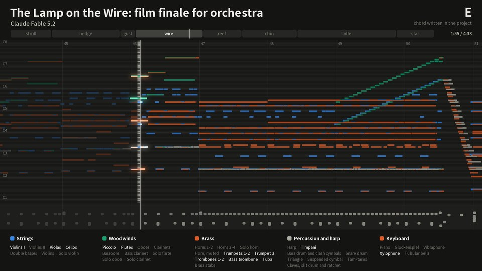
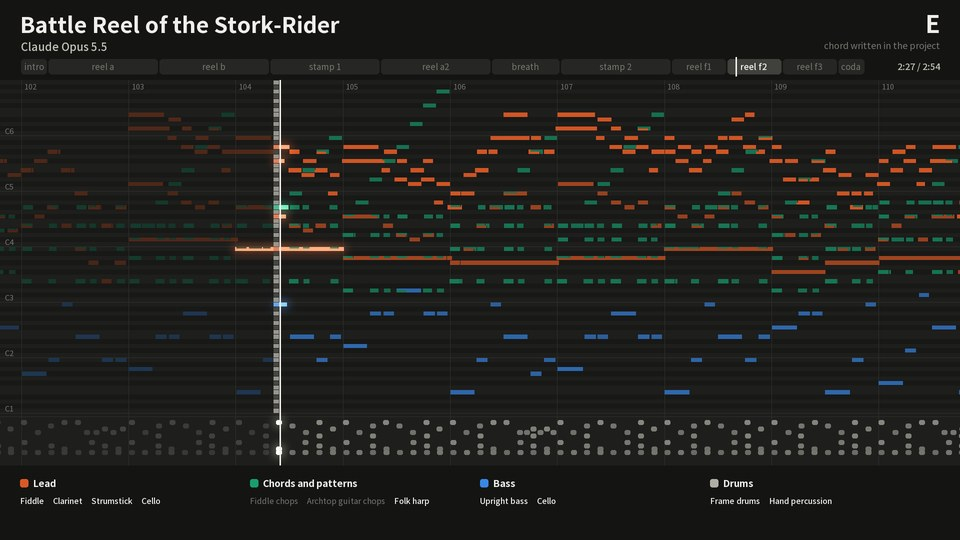
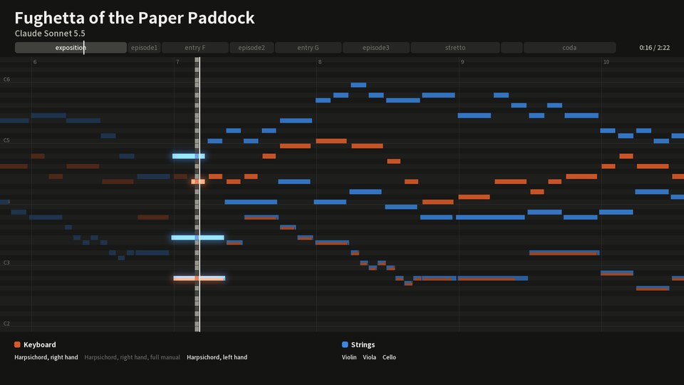
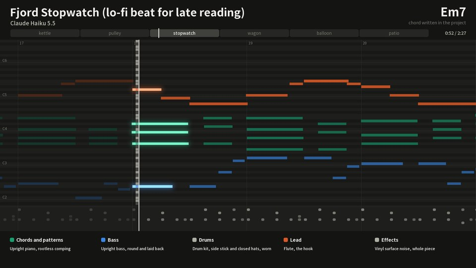
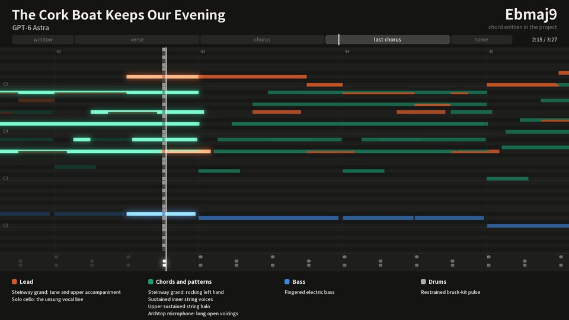
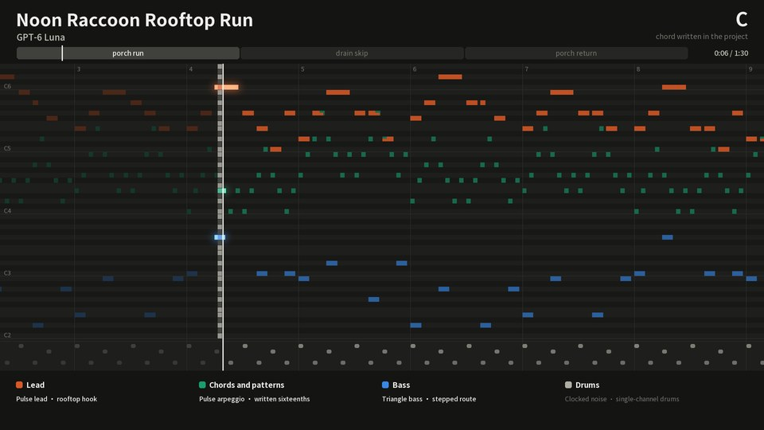
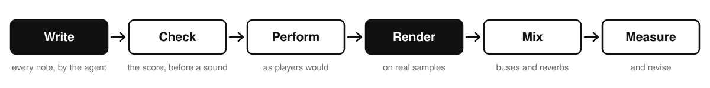

<p align="center">
  <picture>
    <source media="(prefers-color-scheme: dark)" srcset="assets/brand/logo-dark-1200.png">
    
  </picture>
</p>

<p align="center">
  <strong>English</strong> ·
  <a href="README.zh-TW.md">繁體中文</a> ·
  <a href="README.zh-CN.md">简体中文</a> ·
  <a href="README.ja.md">日本語</a> ·
  <a href="README.ko.md">한국어</a>
</p>

<p align="center">
  <a href="https://github.com/owoevan-dev/music-skill/actions/workflows/tests.yml"></a>
  <a href="LICENSE"></a>
  
</p>

<p align="center"><strong>Don't generate it. Compose it.</strong></p>

music-skill is an [Agent Skill](https://agentskills.io) for writing original instrumental music the way a composer and a small studio would. The agent writes every note. The skill checks the score, plays it on sampled instruments, mixes it and masters it.

No audio-generation model is involved. Besides the MP3 and WAV you get the MIDI, a stem per part, and a project file in which any note can be changed and rendered again.

https://github.com/user-attachments/assets/ec1994cd-6e44-4262-9354-a1186ff3304b

## Listen

Six pieces, one by each of six models at xhigh effort. Each was made in one take from one message, [an opening that is the same for all six](examples/prompt.md) and a brief of a few sentences: the agent chose the title, the form and the sounds, wrote every note, and reviewed and revised its own work. Nobody replied to it while it worked, and nobody edited the notes it wrote.

<table>
<tr>
<td width="33%" valign="top"><a href="https://github.com/owoevan-dev/music-skill/releases/download/examples-5/the-lamp-on-the-wire.mp3"></a><br><b><a href="https://github.com/owoevan-dev/music-skill/releases/download/examples-5/the-lamp-on-the-wire.mp3">The Lamp on the Wire</a></b><br>the climax of an animated film, for full orchestra, 4:43<br><sub>Claude Fable 5.2 · <a href="examples/the-lamp-on-the-wire">how it was made</a></sub></td>
<td width="33%" valign="top"><a href="https://github.com/owoevan-dev/music-skill/releases/download/examples-5/battle-reel-of-the-stork-rider.mp3"></a><br><b><a href="https://github.com/owoevan-dev/music-skill/releases/download/examples-5/battle-reel-of-the-stork-rider.mp3">Battle Reel of the Stork-Rider</a></b><br>battle music for a fantasy story, on a folk band, 2:58<br><sub>Claude Opus 5.5 · <a href="examples/battle-reel-of-the-stork-rider">how it was made</a></sub></td>
<td width="33%" valign="top"><a href="https://github.com/owoevan-dev/music-skill/releases/download/examples-5/fughetta-of-the-paper-paddock.mp3"></a><br><b><a href="https://github.com/owoevan-dev/music-skill/releases/download/examples-5/fughetta-of-the-paper-paddock.mp3">Fughetta of the Paper Paddock</a></b><br>a baroque fughetta for harpsichord and strings, 2:28<br><sub>Claude Sonnet 5.5 · <a href="examples/fughetta-of-the-paper-paddock">how it was made</a></sub></td>
</tr>
<tr>
<td width="33%" valign="top"><a href="https://github.com/owoevan-dev/music-skill/releases/download/examples-5/fjord-stopwatch.mp3"></a><br><b><a href="https://github.com/owoevan-dev/music-skill/releases/download/examples-5/fjord-stopwatch.mp3">Fjord Stopwatch</a></b><br>a lo-fi beat for late reading, which loops, 2:32<br><sub>Claude Haiku 5.5 · <a href="examples/fjord-stopwatch">how it was made</a></sub></td>
<td width="33%" valign="top"><a href="https://github.com/owoevan-dev/music-skill/releases/download/examples-5/the-cork-boat-keeps-our-evening.mp3"></a><br><b><a href="https://github.com/owoevan-dev/music-skill/releases/download/examples-5/the-cork-boat-keeps-our-evening.mp3">The Cork Boat Keeps Our Evening</a></b><br>a slow ballad without a singer, 3:33<br><sub>GPT-6 Astra · <a href="examples/the-cork-boat-keeps-our-evening">how it was made</a></sub></td>
<td width="33%" valign="top"><a href="https://github.com/owoevan-dev/music-skill/releases/download/examples-5/noon-raccoon-rooftop-run.mp3"></a><br><b><a href="https://github.com/owoevan-dev/music-skill/releases/download/examples-5/noon-raccoon-rooftop-run.mp3">Noon Raccoon Rooftop Run</a></b><br>8-bit for a platform game's first level, a loop, 1:31<br><sub>GPT-6 Luna · <a href="examples/noon-raccoon-rooftop-run">how it was made</a></sub></td>
</tr>
</table>

Compositions and recordings are CC0; the recordings are MP3 files on the release [examples-5](https://github.com/owoevan-dev/music-skill/releases/tag/examples-5). [Before and after](examples/before-after) changes one note of a short piece, and `compare` shows everything in the render that changed with it: the part, its bus, the reverb's tail and the master.

## Quick start

1. Install the skill. In Claude Code:

   ```
   /plugin marketplace add owoevan-dev/music-skill
   /plugin install music-skill@music-skill
   ```

   For Codex and other agents: `npx skills add owoevan-dev/music-skill`.
2. Ask your agent to set up the renderer and the sound banks. It runs the commands under [Install](#install): about 3.7 GB of downloads, then about five minutes on our test machine.
3. Ask for a piece in plain words:

   > Write a one-minute looping town theme for my RPG: recorder, harp and light strings.

You get an MP3 and a WAV, the MIDI, a stem per part, the buses and reverb returns that add up to the mix, and the project file. On a 24-thread laptop each of the examples above rendered from scratch in 25 seconds (the fughetta and the chiptune) to 156 seconds (the film score, with its 57 parts).

## Why not just generate it?

| | A text-to-music model | music-skill |
|---|---|---|
| Changing one note | regenerate the piece or a section | edit the note; only that part is played again |
| What you get | an audio file | audio, MIDI, a stem per part and the project |
| Where the sounds come from | inside the model | recorded instruments and synthesizers, each named with its licence |
| Fitting a scene or a level | roughly | to the bar: loop points, hit points, exact lengths |
| The same piece again | a new take | the same audio from the same project (Surge XT parts aside) |

If Claude or another agent is already cutting your video or building your game, it knows what the music has to fit: how long each scene runs, where the cuts land, when the narration starts, how a level loops. It can write to those numbers, with a swell that peaks on the reveal, a quieter bed under the voice, a loop as long as the level, and when the edit changes, rewrite just the bars that moved.

## How it works

<p align="center">
  <picture>
    <source media="(prefers-color-scheme: dark)" srcset="docs/images/pipeline-dark.svg">
    
  </picture>
</p>

<details>
<summary><b>The six steps in detail</b></summary>

1. **Write.** The agent settles what the request asks, then draws twelve words at random for the piece and links the request and all twelve into one whole, a scene or a story, which decides what the request left open: the title, the form, the sounds. It writes a plan (what identifies the piece, where its high point is and by what means, what each section commits to), then the project file. Every note's pitch and length go in the score; how it is played (velocity, timing, release) is kept separately. A longer piece is usually written by a short Python script the agent creates, so voicings, bass lines and drum patterns stay readable.
2. **Check the score.** `review` opens with three tables counted from the score (the parts that sound in each section, how often the chord changes, the melody's rhythm) and reads the score against the plan, asking where they differ. It lists sustained minor seconds and ninths between parts; names every note outside the written chords as a passing note, a suspension or another embellishing tone, asking about those not resolved by step; and lists parallel fifths and octaves between independent parts and close intervals too low in the register. Every question has an identifier, and a written decision that begins with it answers it: each one becomes a decision instead of an accident.
3. **Perform.** A performance model adds the kind of deviation players produce: a slow wander in timing and loudness for each player, a laid-back bass, phrase arches, chords whose notes are not struck or released together. Sampled leads can slur and bend.
4. **Render.** FluidSynth plays each sampled part on its own instrument from licensed SoundFont banks. Electronic parts play on built-in synthesizers and drum machines, or on presets of the Surge XT synthesizer.
5. **Mix and master.** Parts go through drum, bass, rhythm, ensemble and lead buses and four generated reverbs, then a master chain to the project's loudness target (−16 LUFS by default, −14 for streaming) with the true peak at or below −1 dBTP. With the mix's newer rules the lead stays close to where you write it and the master ends in a true-peak limiter, and an orchestral piece can say how near it is heard, from among the players to a seat in the hall. Orchestral and organ music can skip the compressors and keep their full dynamics; electronic music can add sidechain ducking, tempo-synced delays, filter sweeps and a loud club master.
6. **Measure.** `analyze` reports each section's level, spectrum and stereo image, how far the melody sits above the accompaniment, and how the master's tonal balance compares with published measurements of commercial recordings or with a reference in its genre. The numbers point at problems; they do not replace listening.

Changing one note synthesizes only that part again, and a part whose notes and mix did not change plays its processed stem from the cache, as a DAW plays a frozen track. Every render mixes all the parts again, so the shared reverbs, their tails and the master follow the change. Each revision is one `round`: it checks the score, renders a draft (the same audio, without the files only delivery needs), measures it and compares it with the previous round, with a short summary of each. `compare` shows what changed between two renders: which parts were synthesized again, and which stems, buses and reverb returns changed, where and by how much.

For a game, a project can loop. The render folds the reverb tail back into the loop start and writes the loop points into a WAV and an Ogg file, in the forms Godot and RPG Maker look for, with a cue point at every section. It can also split the loop into layers that add up to the mix, for music that builds as play heats up.

</details>

## More

<a id="install"></a>

<details>
<summary><b>Install</b></summary>

**Where it runs.** On your own computer, through an agent that runs commands there: it is tested in Claude Code and Codex. The setup needs internet access once and keeps its folder for later sessions, from about 1 GB to about 12 GB with every bank. In claude.ai chat and Cowork it has not been tested; a sandbox that is offline or reset between conversations cannot keep the setup.

**Claude Code**

```
/plugin marketplace add owoevan-dev/music-skill
/plugin install music-skill@music-skill
```

**Codex and other agents**

```
npx skills add owoevan-dev/music-skill
```

Or copy `skills/music-production` into your agent's skills folder.

**The renderer**, once per machine. Your agent can run these for you. In the commands, `<folder>` is a folder you choose outside the skill's own folder; the setup stays there.

Python 3.10 or newer with NumPy. On Linux and macOS a virtual environment keeps NumPy apart from the system's Python and makes `python` the command below (Debian and Ubuntu need `sudo apt install python3-venv` first):

```
python3 -m venv .venv && . .venv/bin/activate        # Windows: py -m venv .venv, then .venv\Scripts\activate
python -m pip install -r skills/music-production/requirements.txt
```

Windows x64 downloads pinned portable builds of FluidSynth and FFmpeg, and the Surge XT synthesizer with the plugin host that runs it (about 55 MB) and its 3,008 patches (about 217 MB); leave the patches out with `--no-surge-catalog`, or all of Surge with `--no-surge`:

```
python skills/music-production/scripts/bootstrap.py --runtime <folder>/.runtime --config <folder>/local-config.json
```

Linux (Ubuntu 24.04, Debian 13 or newer) and macOS use the system packages; Surge XT and its patches are downloaded as on Windows (on Linux, for x86-64):

```
sudo apt install fluidsynth ffmpeg libarchive-tools        # macOS: brew install fluid-synth ffmpeg
python skills/music-production/scripts/bootstrap.py --system --runtime <folder>/.runtime --config <folder>/local-config.json
```

On macOS, Homebrew's `ffmpeg` cannot write a game loop's Ogg copy (`loop.ogg`). For it, run `brew install ffmpeg-full` and add `--ffmpeg "$(brew --prefix ffmpeg-full)/bin/ffmpeg"` to the bootstrap.

Then the sound banks, as this project built them: all thirty are about 3.5 GB to download and 8 GB installed, and the downloads stay in the runtime folder unless you add `--delete-sources`, so keep about 12 GB free. `--only orchestra`, `band`, `world` or `examples` (the banks the examples use) installs a group, or name the banks (`--only vcsl,rusty`); a project that needs a bank you haven't installed stops with the command that adds it. `--from-source` builds the banks from their publishers' samples instead.

```
python skills/music-production/scripts/fetch_soundbanks.py --config <folder>/local-config.json --runtime <folder>/.runtime --output <folder>/local-config.studio.json
```

No GPU, no account, no audio model. Every download comes from its publisher or this project's own release and is checked against a pinned SHA-256.

**What it runs, fetches and sends.** The skill runs its Python scripts, FluidSynth, FFmpeg and, if installed, Surge XT, all on your computer, and renders offline. Its own downloaders fetch tools and sound banks only from github.com and GitHub's download hosts (api.github.com, raw.githubusercontent.com, objects.githubusercontent.com, release-assets.githubusercontent.com) and, when a bank is built from its sources, from the University of Iowa's theremin.music.uiowa.edu, and they refuse a redirect to any other host. Python packages (NumPy, and pedalboard for Surge XT) come through pip, from PyPI unless you have set pip to use another package index; the pedalboard wheel is still checked against its pinned SHA-256. It sends nothing: no telemetry, no account, no uploads ([PRIVACY.md](PRIVACY.md)).

</details>

<details>
<summary><b>Using it</b></summary>

Ask your agent in plain words:

> Write a 90-second instrumental for the title screen of my puzzle game: warm, a little melancholic, piano and strings.

> Make an anime-opening-style track in TV size: a guitar band with a piano melody.

> Write a looping cue for a sad scene in my visual novel: soft piano and cello, quiet enough to read over.

> Write two minutes for full orchestra: a sunrise, from a quiet horn solo to the whole orchestra.

> Make a synthwave cue for a night drive in my racing game: 100 BPM, a gated snare and a gliding lead.

> Write a bossa nova for a rainy café scene: nylon guitar, flute and a soft kit.

> The chorus melody in bar 33 is too busy. Simplify it and render again.

> What changed from the last version? Let me hear the difference.

> Send me the MIDI and the stems too.

</details>

<details>
<summary><b>Sound banks</b></summary>

| Instruments | Banks | Licence |
|---|---|---|
| Pianos and keyboards | Steinway B, a Kawai grand, upright pianos, harpsichords, Yamaha TX81Z FM voices and a pipe organ from VCSL, by Versilian Studios; the Osiris Piano, recorded with and without the sustain pedal, by Karoryfer Samples | CC0 |
| Orchestra | Strings (also by section, tremolo and pizzicato), brass, trombone, tuba, double bass, woodwinds, piccolo and glockenspiel from VSCO 2 Community Edition, by Versilian Studios; harp, mallets, tubular bells, timpani and orchestral percussion from VCSL; horn, bass trombone, clarinets, flutes, solo strings and percussion from the University of Iowa Electronic Music Studios | CC0; Iowa: free for any use without restrictions |
| Band | FreePats FSBS electric guitars (two distorted, one clean); Bass YR, picked and finger, samples by Andrea Biasior; from Karoryfer Samples, Big Rusty Drums, a five-string bass, a pizzicato double bass, an archtop guitar, a baritone sax and a tuba; a solo cello by Karoryfer Lecolds and bigcat instruments; a nylon-string classical guitar from the University of Iowa Electronic Music Studios | CC0; Iowa: free for any use without restrictions |
| Solo and world | Tenor sax, saxello, recorders, ocarina, harmonicas, folk harp, dan tranh, psaltery, kalimbas, balafon and world percussion from VCSL; an erhu; a tenor steel pan; a sung "ah" | CC0; steel pan: Unlicense |
| Synthesizers | Built-in synthesizers and drum machines; Surge XT with its 3,008 factory and third-party patches, fifty of them curated, optional and installed by default | built in: MIT; Surge XT: GPL-3.0, run by a separate GPL program |
| Everything else | MuseScore MS Basic | MIT |

Every recorded bank is CC0, free for any use without restrictions (the Iowa recordings) or dedicated to the public domain (the steel pan), so what you make with them needs no credit. Surge XT is GPL-3.0 and runs only inside a separate GPL program of this project (`surge_host.py`); the GPL covers the programs, not the music they play. MS Basic, the General MIDI bank that other parts fall back to, is MIT: its notices go with copies and adaptations of the bank, and music played on it needs no credit either. [THIRD_PARTY.md](THIRD_PARTY.md) lists the sources and how we read each licence.

</details>

<details>
<summary><b>How well it works</b></summary>

`selfcheck.py` runs 160 checks (130 without a renderer configuration), from MIDI round trips and archive safety to real renders. A one-note revision synthesizes one part again, and `compare` finds the change from that note on, in every file it reached and nowhere else. The older single-room mix reproduces an earlier release bit for bit. The loudness meter reads −3.01 LUFS for the BS.1770 reference tone. CI runs every check, renders included, on Ubuntu with FluidSynth 2.3 and FFmpeg 6.1, on macOS with FluidSynth 2.6 and FFmpeg 9.0, and on Windows with the pinned FluidSynth 2.6.1 and FFmpeg 9.0.2 and with Surge XT.

Whether the music is good is another matter, and only listening can tell. The pieces above are the best evidence this repository has.

</details>

<details>
<summary><b>Questions</b></summary>

**Can I use the music in a video, a game or a commercial release?** Nothing in the toolchain stands in the way. No sound bank asks for a credit: the optional ones are CC0 or free for any use, and MS Basic's MIT licence asks nothing of music played on it. The GPL programs (FFmpeg, Surge XT) cover the programs, not the music that passes through them. Whether you hold a copyright in music an agent wrote for you depends on your country's law and on how much of it you shaped.

**Which agents can use it?** Any agent that loads Agent Skills and can run Python: Claude Code as a plugin, Codex, and others through `npx skills`.

**Does it need the internet or a GPU?** The internet only for setup; rendering runs offline on the CPU. Your project files reach no one except through your agent, which sends what it reads to its own model.

**Can I use my own instruments?** Any SF2 bank: `studio.py add-soundfont` adds it to your configuration and a part names it ([soundbanks.md](skills/music-production/references/soundbanks.md)). A bank you add keeps its own licence, so check it before you publish music made with it.

</details>

<details>
<summary><b>Limits</b></summary>

- It doesn't sing or write lyrics. Of plugins it runs only Surge XT; your own VST plugins are not supported yet.
- The sound is only as good as the free banks. The YR basses have one velocity layer, the section strings speak slowly, marimba, xylophone and piccolo are sampled sparsely, and a sampled guitar bend shifts the whole sample instead of changing the string's tone.
- No bank yet covers steel-string acoustic guitars, a choir or East Asian instruments beyond an erhu and a dan tranh; such parts fall back to MS Basic's sparse General MIDI samples.
- Surge XT starts its oscillators at random phases, so a Surge part is a slightly different take each time it is synthesized; the render cache keeps a take until the part changes. Its tempo-synced delays and LFOs follow one tempo per part, the written tempo most of its notes start under, so a pickup or a ritardando does not set it and a later tempo change does not move it. Everything else renders the same every time.
- The agent cannot listen. `review` and `analyze` locate problems; a person has to hear the result, and the skill tells the agent never to claim it listened.
- A long piece with many synthesizer or effect parts needs memory, up to about 2 GB for each part rendered at once; the renderer runs fewer parts at a time when free memory is short, and `--jobs` sets the number.
- Linux and macOS use the system FluidSynth and FFmpeg, so their samples can differ slightly from the pinned Windows builds.

</details>

## Documentation

| | |
|---|---|
| [SKILL.md](skills/music-production/SKILL.md) | The workflow the agent follows, and every command |
| [schema.md](skills/music-production/references/schema.md) | The project file: score, performance and mix |
| [arrangement.md](skills/music-production/references/arrangement.md) | Form, melody, voicing and the jobs of the parts |
| [performance-and-mix.md](skills/music-production/references/performance-and-mix.md) | Performance and the bus chain |
| [measuring.md](skills/music-production/references/measuring.md) | Reading `analyze` and `compare` |
| [soundbanks.md](skills/music-production/references/soundbanks.md) | The sound banks and adding your own; their presets, measured quirks and building a bank in the files it links |
| [outputs.md](skills/music-production/references/outputs.md) | What each command writes, key by key |
| [Genre guides](skills/music-production/references) | Electronic music and techno, hip-hop beats and trap, jazz, blues, bossa nova and funk, rock and metal, pop and ballads, film scores and horror, anime openings, game and scene music, orchestra, baroque, organ, piano and chamber music |
| [setup.md](skills/music-production/references/setup.md) | Installing the renderer on Windows, Linux and macOS |
| [sources-and-rights.md](skills/music-production/references/sources-and-rights.md) | Using outside scores, MIDI and samples |

## Contributing

Bug reports, listening notes and sound bank suggestions are welcome as [issues](https://github.com/owoevan-dev/music-skill/issues). Questions and ideas go to [Discussions](https://github.com/owoevan-dev/music-skill/discussions), where you can also share music you made with the skill. Pull requests from outside the project are closed for now; [CONTRIBUTING.md](CONTRIBUTING.md) explains why, and what to do instead.

## Licence

[MIT](LICENSE) for this project's own code and documentation; third-party data, measurements of it and quoted excerpts keep their own terms, listed in [THIRD_PARTY.md](THIRD_PARTY.md). The example recordings and compositions are dedicated to the public domain under [CC0 1.0](https://creativecommons.org/publicdomain/zero/1.0/). Third-party tools and sound banks keep their own licences and are not in this repository: the tools come from their publishers and all thirty banks from this project's release, twenty-five built from the publishers' samples and five repacked unchanged from FreePats. `skills/music-production/scripts/surge_host.py` is GPL-3.0-or-later, the licence of the Surge XT and pedalboard it runs. The pictures of the examples are drawn by code from their project files, their lettering in Noto Sans TC (SIL Open Font License), and the logo's lettering is Noto Serif TC (SIL Open Font License) turned into outlines.
