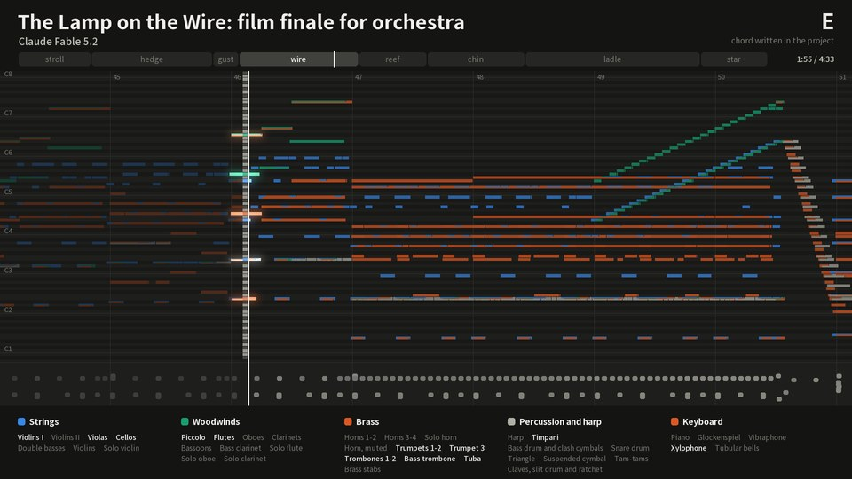
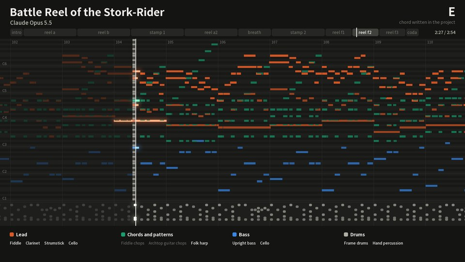
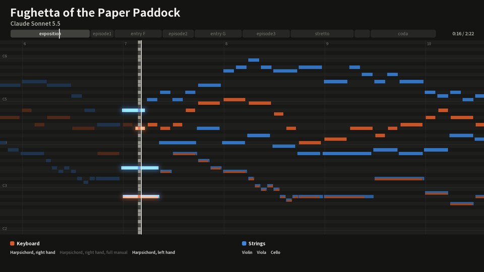
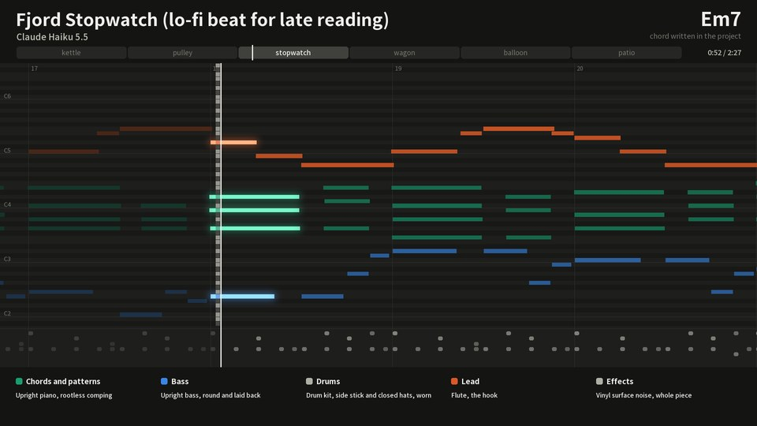
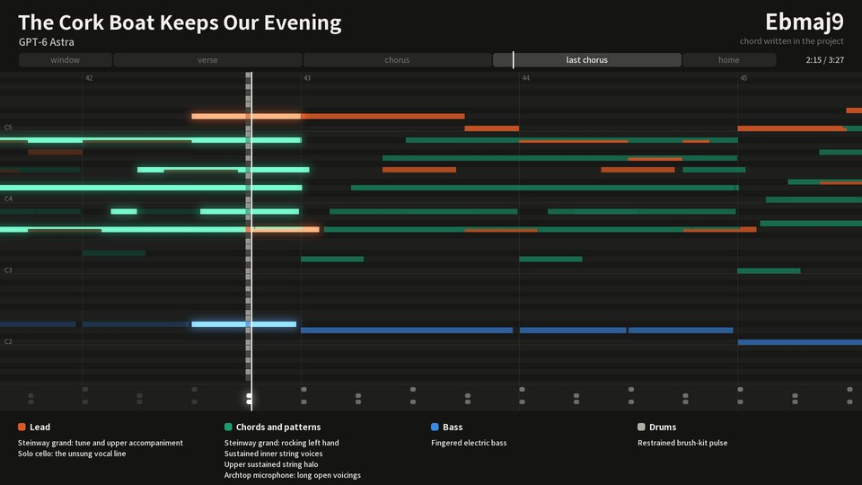
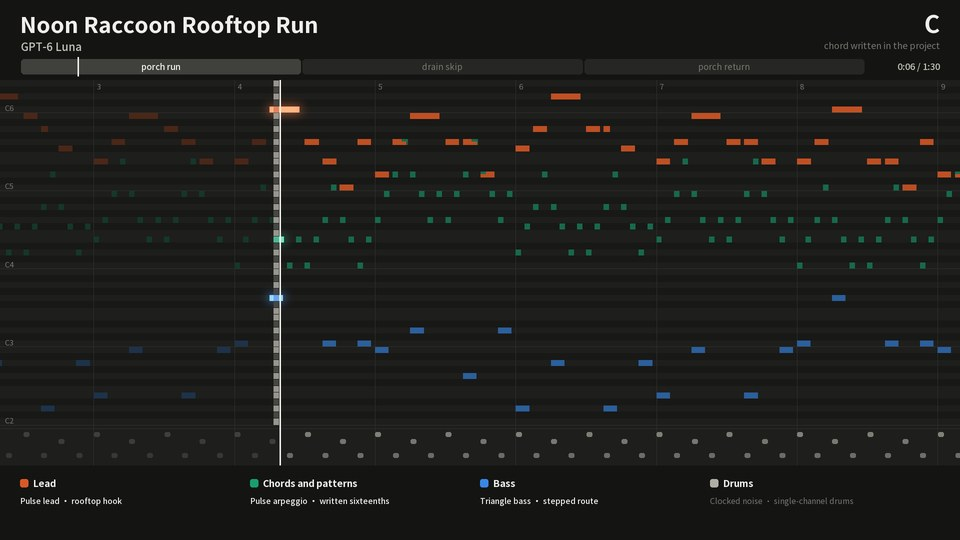

<p align="center">
  <picture>
    <source media="(prefers-color-scheme: dark)" srcset="assets/brand/logo-dark-1200.png">
    
  </picture>
</p>

<p align="center">
  <a href="README.md">English</a> ·
  <strong>繁體中文</strong> ·
  <a href="README.zh-CN.md">简体中文</a> ·
  <a href="README.ja.md">日本語</a> ·
  <a href="README.ko.md">한국어</a>
</p>

<p align="center">
  <a href="https://github.com/owoevan-dev/music-skill/actions/workflows/tests.yml"></a>
  <a href="LICENSE"></a>
  
</p>

<p align="center"><strong>不是生成，是作曲。</strong></p>

music-skill 是一個 [Agent Skill](https://agentskills.io)，讓 AI agent 像作曲家加上一間小錄音室那樣，寫出原創的器樂曲。每一個音都由 agent 寫下，skill 負責檢查樂譜、用取樣樂器演奏、混音和母帶後製。

整個過程沒有用到任何音訊生成模型。除了 MP3 和 WAV，你還會拿到 MIDI、每個聲部各自的音軌，以及一份專案檔：裡面任何一個音都能改，改完再重新渲染。

https://github.com/user-attachments/assets/ec1994cd-6e44-4262-9354-a1186ff3304b

<p align="center"><sub>六首範例各 8 秒，取各自最密集的片段；畫面直接從專案檔畫出，聲音就是錄音本身。</sub></p>

## 試聽

六首曲子，六個模型各一首，都用 xhigh effort。每首都是單次完成，只給了一則訊息：[六首共用的開頭](examples/prompt.md)，加上幾句需求。曲名、曲式和音色都由 agent 自己決定，每個音都是它寫的，審查和修改也由它自己完成。製作期間沒有人回覆它，它寫的音符也沒有人修改過。

<table>
<tr>
<td width="33%" valign="top"><a href="https://github.com/owoevan-dev/music-skill/releases/download/examples-5/the-lamp-on-the-wire.mp3"></a><br><b><a href="https://github.com/owoevan-dev/music-skill/releases/download/examples-5/the-lamp-on-the-wire.mp3">《The Lamp on the Wire》</a></b><br>動畫電影的高潮配樂，完整管弦樂團，4:43<br><sub>Claude Fable 5.2 · <a href="examples/the-lamp-on-the-wire">製作過程</a></sub></td>
<td width="33%" valign="top"><a href="https://github.com/owoevan-dev/music-skill/releases/download/examples-5/battle-reel-of-the-stork-rider.mp3"></a><br><b><a href="https://github.com/owoevan-dev/music-skill/releases/download/examples-5/battle-reel-of-the-stork-rider.mp3">《Battle Reel of the Stork-Rider》</a></b><br>奇幻故事的戰鬥曲，民謠樂團演奏，2:58<br><sub>Claude Opus 5.5 · <a href="examples/battle-reel-of-the-stork-rider">製作過程</a></sub></td>
<td width="33%" valign="top"><a href="https://github.com/owoevan-dev/music-skill/releases/download/examples-5/fughetta-of-the-paper-paddock.mp3"></a><br><b><a href="https://github.com/owoevan-dev/music-skill/releases/download/examples-5/fughetta-of-the-paper-paddock.mp3">《Fughetta of the Paper Paddock》</a></b><br>巴洛克小賦格，大鍵琴與弦樂，2:28<br><sub>Claude Sonnet 5.5 · <a href="examples/fughetta-of-the-paper-paddock">製作過程</a></sub></td>
</tr>
<tr>
<td width="33%" valign="top"><a href="https://github.com/owoevan-dev/music-skill/releases/download/examples-5/fjord-stopwatch.mp3"></a><br><b><a href="https://github.com/owoevan-dev/music-skill/releases/download/examples-5/fjord-stopwatch.mp3">《Fjord Stopwatch》</a></b><br>深夜閱讀的 lo-fi，可循環，2:32<br><sub>Claude Haiku 5.5 · <a href="examples/fjord-stopwatch">製作過程</a></sub></td>
<td width="33%" valign="top"><a href="https://github.com/owoevan-dev/music-skill/releases/download/examples-5/the-cork-boat-keeps-our-evening.mp3"></a><br><b><a href="https://github.com/owoevan-dev/music-skill/releases/download/examples-5/the-cork-boat-keeps-our-evening.mp3">《The Cork Boat Keeps Our Evening》</a></b><br>沒有歌手的抒情慢歌，3:33<br><sub>GPT-6 Astra · <a href="examples/the-cork-boat-keeps-our-evening">製作過程</a></sub></td>
<td width="33%" valign="top"><a href="https://github.com/owoevan-dev/music-skill/releases/download/examples-5/noon-raccoon-rooftop-run.mp3"></a><br><b><a href="https://github.com/owoevan-dev/music-skill/releases/download/examples-5/noon-raccoon-rooftop-run.mp3">《Noon Raccoon Rooftop Run》</a></b><br>平台遊戲第一關的 8-bit，可循環，1:31<br><sub>GPT-6 Luna · <a href="examples/noon-raccoon-rooftop-run">製作過程</a></sub></td>
</tr>
</table>

樂曲和錄音都是 CC0；錄音是 MP3 檔，放在 release [examples-5](https://github.com/owoevan-dev/music-skill/releases/tag/examples-5)。[原版與修改版對照](examples/before-after) 把一首小曲改掉一個音，再用 `compare` 列出渲染裡跟著變的所有地方：那個聲部、它的匯流排、殘響尾巴和母帶。

## 快速開始

1. 安裝這個 skill。在 Claude Code 裡：

   ```
   /plugin marketplace add owoevan-dev/music-skill
   /plugin install music-skill@music-skill
   ```

   Codex 和其他 agent：`npx skills add owoevan-dev/music-skill`。
2. 請 agent 安裝渲染工具和音色庫。它會執行[安裝](#install)一節的指令：下載約 3.7 GB，在我們的測試電腦上接著約五分鐘就完成其餘步驟。
3. 用平常的話點一首曲子：

   > 幫我的 RPG 寫一首一分鐘、可以循環的城鎮主題：直笛、豎琴和輕柔的弦樂。

你會拿到 MP3 和 WAV、MIDI、每個聲部的分軌、加起來就是完整混音的匯流排與殘響回送，以及專案檔。在一台 24 執行緒的筆電上，上面的範例從零開始渲染，每首花了 25 秒（小賦格和 8-bit 曲）到 156 秒（57 個聲部的電影配樂）。

## 為什麼不直接生成？

| | 文字轉音樂的模型 | music-skill |
|---|---|---|
| 改一個音 | 重新生成整首或其中一段 | 直接改那個音，只重新演奏那個聲部 |
| 你拿到什麼 | 一個音訊檔 | 音訊、MIDI、每個聲部的分軌和專案檔 |
| 聲音從哪裡來 | 模型內部 | 錄下的真實樂器和合成器，每一個都標明授權 |
| 配合場景或關卡 | 大致吻合 | 精確到小節：循環點、命中點、準確的長度 |
| 同一首再做一次 | 新的一次生成 | 同一個專案渲染出相同的聲音（Surge XT 聲部除外） |

如果 Claude 或其他 agent 已經在幫你剪影片或做遊戲，它本來就知道音樂要配合什麼：每個場景多長、轉場落在哪裡、旁白何時開始、關卡怎麼循環。它可以照著這些數字寫：在揭曉的那一刻推到最高點、旁白底下的配樂收小、循環和關卡一樣長；剪輯改了，就只重寫移動到的那幾小節。

## 運作方式

<p align="center">
  <picture>
    <source media="(prefers-color-scheme: dark)" srcset="docs/images/pipeline.zh-TW-dark.svg">
    
  </picture>
</p>

<details>
<summary><b>六個步驟的細節</b></summary>

1. **寫譜**：agent 先確定需求要的是什麼，再替這首曲子隨機抽出十二個詞，把需求和這十二個詞連成一個整體（一個場景或一段故事），由它決定需求沒說到的部分：曲名、曲式、音色。接著寫下計畫（這首曲子靠什麼辨認、高潮在哪裡、用什麼手段、每個段落要做到什麼），再寫出專案檔。每個音的音高和長度記在樂譜裡；怎麼演奏（力度、時間點、放開的時機）另外記錄。較長的曲子通常由 agent 寫一支簡短的 Python 腳本來產生，讓和聲配置、貝斯線和鼓的樂句都清楚好改。
2. **檢查樂譜**：`review` 一開頭先列出三張從樂譜算出的表（每個段落有哪些聲部發聲、和弦多久換一次、旋律的節奏），再拿樂譜對照計畫，問出兩者不符的地方。它會列出聲部之間持續的小二度和小九度；為和弦外的每個音標出經過音、掛留音等非和弦音的類型，並詢問沒有級進解決的音；還會列出獨立聲部之間的平行五度、八度，以及音域過低的密集音程。每個問題都有識別碼，以它開頭的書面決定就是對那個問題的回答，讓每一處都是刻意的選擇，而不是意外。
3. **演奏**：演奏模型加上真人演奏會有的偏差：每位樂手在時間和音量上緩慢的起伏、稍微拖拍的貝斯、樂句的起伏弧線，以及和弦裡各音不會同時按下、也不會同時放開。取樣的主旋律可以圓滑奏，也可以推弦。
4. **渲染**：FluidSynth 用有授權的 SoundFont 音色庫，讓每個取樣聲部用各自的樂器演奏；電子聲部則由內建的合成器和鼓機，或 Surge XT 合成器的音色演奏。
5. **混音與母帶**：各聲部經過鼓、貝斯、節奏、合奏和主旋律匯流排，以及四種自動生成的殘響，最後由母帶處理做到 專案的目標響度（預設 −16 LUFS，串流常用 −14 LUFS），真峰值不超過 −1 dBTP。採用新版混音規則時，主旋律會保持在你寫的音量附近，母帶以真峰值限制器收尾；管弦樂曲還能指定聽起來離樂手多近，從樂手身邊到音樂廳的座位。管弦樂與管風琴可以略過壓縮器，保留完整的強弱對比；電子音樂可以加上側鏈閃避、跟著速度走的延遲、濾波掃頻，以及俱樂部等級的響亮母帶。
6. **量測**：`analyze` 會量出每個段落的響度、頻譜和立體聲、主旋律比伴奏大聲多少，並把母帶的音色平衡拿去和已發表的商業錄音量測，或同曲風的參考比較。這些數字能指出問題所在，但不能取代實際聆聽。

只改一個音，就只會重新合成那一個聲部；音符和混音都沒變的聲部，會像 DAW 裡凍結的音軌一樣，直接使用快取中處理好的分軌。每次渲染都會用所有聲部重新混音，所以共用殘響、殘響尾巴和母帶都會跟著改變。每一輪修改用一次 `round`：檢查樂譜、渲染草稿（聲音相同，只省去交付才需要的檔案）、測量，再與上一輪比較，每一步都給出簡短摘要。`compare` 會列出兩次渲染之間的差異：哪些聲部重新合成，以及哪些分軌、匯流排和殘響回送有變、變在哪裡、差多少。

遊戲用的專案可以設定循環：渲染時會把殘響尾巴折回循環開頭，並用 Godot 和 RPG Maker 讀取的格式，把循環點寫進 WAV 與 Ogg 檔，每個段落也標上提示點。循環還能拆成幾層，各層加起來就是完整混音，讓音樂隨著遊戲緊張程度逐層加厚。

</details>

## 更多內容

<a id="install"></a>

<details>
<summary><b>安裝</b></summary>

**在哪裡執行。** 在你自己的電腦上，透過能在那裡執行指令的 agent 使用；已在 Claude Code 和 Codex 測試過。安裝時需要連網一次，並會保留它的資料夾供之後的工作階段使用，大小從約 1 GB 到裝滿全部音色庫的約 12 GB。claude.ai 的對話和 Cowork 尚未測試；離線或每次對話都會重設的沙盒無法保留安裝。

**Claude Code**

```
/plugin marketplace add owoevan-dev/music-skill
/plugin install music-skill@music-skill
```

**Codex 與其他 agent**

```
npx skills add owoevan-dev/music-skill
```

也可以直接把 `skills/music-production` 複製到 agent 的 skills 資料夾。

**渲染工具**：每台電腦設定一次，可以交給 agent 代勞。指令裡的 `<folder>` 是你自選的資料夾，放在 skill 自己的資料夾之外，安裝的內容會留在那裡。

需要 Python 3.10 以上和 NumPy。在 Linux 和 macOS 上，用虛擬環境把 NumPy 和系統的 Python 分開，下面的指令也就能用 `python`（Debian 和 Ubuntu 要先 `sudo apt install python3-venv`）：

```
python3 -m venv .venv && . .venv/bin/activate        # Windows: py -m venv .venv, then .venv\Scripts\activate
python -m pip install -r skills/music-production/requirements.txt
```

Windows x64 會下載鎖定版本的 FluidSynth 和 FFmpeg 免安裝版，以及 Surge XT 合成器和執行它的外掛主程式（約 55 MB）與它的 3,008 個音色（約 217 MB）；加上 `--no-surge-catalog` 就不裝這些音色，加上 `--no-surge` 就完全不裝 Surge：

```
python skills/music-production/scripts/bootstrap.py --runtime <folder>/.runtime --config <folder>/local-config.json
```

Linux（Ubuntu 24.04、Debian 13 或更新）和 macOS 使用系統套件；Surge XT 和它的音色會像 Windows 一樣自動下載（Linux 限 x86-64）：

```
sudo apt install fluidsynth ffmpeg libarchive-tools        # macOS：brew install fluid-synth ffmpeg
python skills/music-production/scripts/bootstrap.py --system --runtime <folder>/.runtime --config <folder>/local-config.json
```

macOS 上 Homebrew 的 `ffmpeg` 無法輸出遊戲迴圈的 Ogg 版本（`loop.ogg`）。需要時請執行 `brew install ffmpeg-full`，並在 bootstrap 指令加上 `--ffmpeg "$(brew --prefix ffmpeg-full)/bin/ffmpeg"`。

接著下載音色庫（本專案建好的版本）：全部三十個下載約 3.5 GB、安裝後約 8 GB；除非加上 `--delete-sources`，下載的檔案會留在 runtime 資料夾，所以請預留約 12 GB。`--only orchestra`、`band`、`world` 或 `examples`（範例曲用到的音色庫）可以只裝一組，也可以直接寫音色庫名稱（`--only vcsl,rusty`）；專案用到還沒安裝的音色庫時，會停下來並列出安裝指令。加上 `--from-source` 則改從各發布者的原始取樣自行建置。

```
python skills/music-production/scripts/fetch_soundbanks.py --config <folder>/local-config.json --runtime <folder>/.runtime --output <folder>/local-config.studio.json
```

不需要 GPU、帳號或音訊模型。所有檔案都從發布者或本專案自己的 release 下載，並以鎖定的 SHA-256 核對。

**它執行什麼、下載什麼、傳送什麼**：skill 執行的是它的 Python 腳本、FluidSynth、FFmpeg，以及已安裝時的 Surge XT，全部在你的電腦上執行，渲染不需要連網。skill 自己的下載程式只從 github.com 和 GitHub 的下載主機（api.github.com、raw.githubusercontent.com、objects.githubusercontent.com、release-assets.githubusercontent.com）下載工具和音色庫；只有從原始錄音建置音色庫時，才會連到愛荷華大學的 theremin.music.uiowa.edu。它會拒絕轉址到其他主機。Python 套件（NumPy，以及 Surge XT 用的 pedalboard）透過 pip 下載，除非你替 pip 設定了其他套件索引，否則來自 PyPI；pedalboard 的 wheel 仍會以鎖定的 SHA-256 核對。它不傳送任何東西：沒有遙測、沒有帳號、不上傳（[PRIVACY.md](PRIVACY.md)）。

</details>

<details>
<summary><b>使用方式</b></summary>

直接用平常的話告訴 agent：

> 幫我的益智遊戲標題畫面寫一首 90 秒的器樂曲，溫暖、帶點憂傷，用鋼琴和弦樂。

> 做一首 TV 尺寸的動漫片頭風格曲子，吉他樂團配鋼琴主旋律。

> 幫我的視覺小說寫一段悲傷場景的循環配樂：柔和的鋼琴和大提琴，安靜到可以邊聽邊讀。

> 寫兩分鐘的管弦樂：日出，從安靜的法國號獨奏到整個樂團。

> 幫我的賽車遊戲寫一段夜間駕駛的 synthwave 配樂：100 BPM，閘門殘響小鼓，滑音主旋律。

> 幫雨天咖啡館的場景寫一首巴薩諾瓦：尼龍弦吉他、長笛和輕柔的鼓。

> 第 33 小節的副歌旋律太忙了，簡化一下再重新渲染。

> 跟上一版比，改了哪裡？讓我聽聽差別。

> 也把 MIDI 和分軌給我。

</details>

<details>
<summary><b>音色庫</b></summary>

| 樂器 | 音色庫 | 授權 |
|---|---|---|
| 鋼琴與鍵盤 | VCSL（Versilian Studios）的 Steinway B、Kawai 平台鋼琴、直立鋼琴、大鍵琴、Yamaha TX81Z FM 音色和管風琴；Karoryfer Samples 的 Osiris Piano，分別錄了踩與不踩延音踏板的版本 | CC0 |
| 管弦樂 | VSCO 2 Community Edition（Versilian Studios）的弦樂（含分部、震音與撥奏）、銅管、長號、低音號、低音提琴、木管、短笛和鐘琴；VCSL 的豎琴、木槌類打擊樂、管鐘、定音鼓和管弦打擊樂；愛荷華大學電子音樂工作室的法國號、低音長號、單簧管、長笛、獨奏弦樂和打擊樂 | CC0；愛荷華：可自由用於任何用途，沒有限制 |
| 樂團 | FreePats FSBS 電吉他（兩種破音、一種乾淨音色）；Bass YR 撥片與指彈貝斯，取樣由 Andrea Biasior 錄製；Karoryfer Samples 的 Big Rusty Drums、五弦貝斯、撥奏低音提琴、弧頂爵士吉他、上低音薩克斯風和低音號；Karoryfer Lecolds 與 bigcat instruments 的獨奏大提琴；愛荷華大學電子音樂工作室的尼龍弦古典吉他 | CC0；愛荷華：可自由用於任何用途，沒有限制 |
| 獨奏與世界樂器 | VCSL 的次中音薩克斯風、saxello、直笛、陶笛、口琴、民謠豎琴、越南箏（đàn tranh）、psaltery（撥弦齊特琴）、卡林巴、巴拉風和世界打擊樂；二胡；次中音鋼鼓；人聲「啊」 | CC0；鋼鼓：Unlicense |
| 合成器 | 內建的合成器與鼓機；Surge XT 和它的 3,008 個原廠與第三方音色（其中五十個精選），選用、預設安裝 | 內建：MIT；Surge XT：GPL-3.0，由獨立的 GPL 程式執行 |
| 其他樂器 | MuseScore MS Basic | MIT |

錄音音色庫都是 CC0、可自由用於任何用途而沒有限制（愛荷華大學的錄音），或已捐贈給公有領域（鋼鼓），用它們做的音樂不需要署名。Surge XT 採用 GPL-3.0，只在本專案一個獨立的 GPL 程式（`surge_host.py`）裡執行；GPL 規範的是程式本身，不是它們演奏出來的音樂。MS Basic 是其他聲部退而使用的 General MIDI 音色庫，採用 MIT：它的聲明隨音色庫本身的複製和改作保留，用它演奏的音樂同樣不需要署名。來源和我們對各項授權的解讀列在 [THIRD_PARTY.md](THIRD_PARTY.md)。

</details>

<details>
<summary><b>效果如何</b></summary>

`selfcheck.py` 共有 160 項檢查（沒有渲染設定時為 130 項），從 MIDI 來回轉換、壓縮檔安全，到實際渲染都包括在內。例如：只改一個音時只會重新合成一個聲部，而 `compare` 只在受影響的檔案裡、從那個音開始找到差異；舊的單一殘響混音能逐位元重現先前的版本；響度量測對 BS.1770 的標準測試音讀出 −3.01 LUFS。CI 會跑完所有檢查（包括渲染），環境是 Ubuntu（FluidSynth 2.3、FFmpeg 6.1）、macOS（FluidSynth 2.6、FFmpeg 9.0）和 Windows（固定版本的 FluidSynth 2.6.1、FFmpeg 9.0.2，加上 Surge XT）。

音樂好不好聽是另一回事，只有實際聆聽才知道。上面這些曲子是這個 repo 最好的證據。

</details>

<details>
<summary><b>常見問題</b></summary>

**做出來的音樂可以用在影片、遊戲或商業作品嗎？** 工具本身沒有任何限制。音色庫都不需要署名：選用音色庫是 CC0 或可自由使用，MS Basic 的 MIT 授權對用它演奏的音樂沒有任何要求。GPL 授權的程式（FFmpeg、Surge XT）規範的是程式本身，不是經過它們處理的音樂。至於你對 agent 幫你寫的音樂是否享有著作權，取決於你所在地的法律，以及你參與塑造了多少。

**哪些 agent 可以用？** 任何能載入 Agent Skills 並執行 Python 的 agent：Claude Code（以外掛安裝）、Codex，以及透過 `npx skills` 安裝的其他 agent。

**需要網路或 GPU 嗎？** 只有安裝時需要網路；渲染在 CPU 上離線進行。你的專案檔不會傳給任何人，只有你的 agent 會把它讀到的內容送給它自己的模型。

**可以用自己的樂器嗎？** 任何 SF2 音色庫都可以：用 `studio.py add-soundfont` 加進設定檔，再在聲部裡指定它（見 [soundbanks.md](skills/music-production/references/soundbanks.md)）。自己加的音色庫保留它原本的授權，發表作品前請先確認。

</details>

<details>
<summary><b>限制</b></summary>

- 不會唱歌、不寫歌詞。外掛只支援 Surge XT，還不能載入你自己的 VST 外掛。
- 音色的上限取決於免費音色庫：YR 貝斯只有一層力度，弦樂起音偏慢，馬林巴、木琴與短笛的取樣稀疏，取樣吉他的推弦是把整段取樣變調，不會有真實琴弦的音色變化。
- 目前還沒有鋼弦木吉他、合唱，以及二胡和越南箏以外的東亞樂器音色庫；這些聲部只能用 MS Basic 取樣稀疏的 General MIDI 音色。
- Surge XT 的振盪器每次都從隨機相位開始，所以同一個 Surge 聲部每次合成都會有細微差異；渲染快取會保留一次的結果，直到這個聲部改動為止。它的節拍同步延遲和 LFO 每個聲部只用一個速度：該聲部大多數音符起始時的樂譜速度，所以弱起拍或漸慢不會決定它，曲中變速也不會跟著改。其他部分每次渲染都完全相同。
- agent 聽不到聲音。`review` 和 `analyze` 只能找出問題，結果必須由人來聽；skill 也要求 agent 不得宣稱自己聽過。
- 長曲裡如果有很多合成器或效果處理的聲部，會用掉不少記憶體，同時渲染的每個聲部最多約 2 GB；可用記憶體不足時，渲染程式會自動減少同時處理的聲部數，也可以用 `--jobs` 指定。
- Linux 和 macOS 使用系統的 FluidSynth 和 FFmpeg，渲染出的取樣可能和 Windows 的鎖定版本有些微差異。

</details>

## 文件

| | |
|---|---|
| [SKILL.md](skills/music-production/SKILL.md) | agent 依循的工作流程，以及所有指令 |
| [schema.md](skills/music-production/references/schema.md) | 專案檔：樂譜、演奏與混音 |
| [arrangement.md](skills/music-production/references/arrangement.md) | 曲式、旋律、和聲配置與各聲部的職責 |
| [performance-and-mix.md](skills/music-production/references/performance-and-mix.md) | 演奏與匯流排混音 |
| [measuring.md](skills/music-production/references/measuring.md) | 如何解讀 `analyze` 與 `compare` |
| [soundbanks.md](skills/music-production/references/soundbanks.md) | 各音色庫，以及如何加入自己的音色庫；預設音色、測得的特性與如何製作音色庫見其連結的檔案 |
| [outputs.md](skills/music-production/references/outputs.md) | 各指令寫出的檔案，逐一說明每個鍵 |
| [曲風指南](skills/music-production/references) | 電子音樂與 techno、嘻哈節拍與 trap、爵士、藍調、巴薩諾瓦與放克、搖滾與金屬、流行與抒情曲、電影配樂與恐怖、動漫片頭、遊戲與場景配樂、管弦樂、巴洛克、管風琴、鋼琴與室內樂 |
| [setup.md](skills/music-production/references/setup.md) | 在 Windows、Linux 和 macOS 安裝渲染工具 |
| [sources-and-rights.md](skills/music-production/references/sources-and-rights.md) | 使用外部樂譜、MIDI 與取樣的注意事項 |

文件本身以英文撰寫。

## 參與貢獻

歡迎在 [Issues](https://github.com/owoevan-dev/music-skill/issues) 回報錯誤、提供試聽意見或推薦音色庫。使用上的問題和想法請到 [Discussions](https://github.com/owoevan-dev/music-skill/discussions)，也歡迎在那裡分享用這個 skill 做的音樂。目前不接受專案外部的 Pull Request，原因和替代做法寫在 [CONTRIBUTING.md](CONTRIBUTING.md)。

## 授權

本專案自己的程式碼與文件採用 [MIT](LICENSE) 授權；第三方資料、對它們的測量結果和引用的片段保留各自的條款，列在 [THIRD_PARTY.md](THIRD_PARTY.md)。範例的錄音與樂曲以 [CC0 1.0](https://creativecommons.org/publicdomain/zero/1.0/) 釋出到公有領域。第三方工具和音色庫保留各自的授權，不包含在這個 repo 裡：工具從發布者下載，三十個音色庫都從本專案的 release 下載，其中二十五個以發布者的取樣建置，五個是 FreePats 的原檔重新打包。`skills/music-production/scripts/surge_host.py` 採用 GPL-3.0-or-later，與它執行的 Surge XT 和 pedalboard 相同。範例的圖是程式直接從各自的專案檔畫出來的，圖中文字用 Noto Sans TC（SIL Open Font License）；logo 的文字是將 Noto Serif TC（SIL Open Font License）轉成外框。
